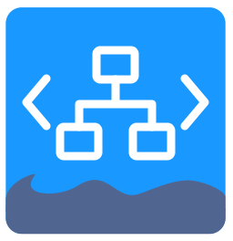

<!-- markdownlint-disable-next-line first-line-heading -->

#  Continuous Integration - GitHub - IaC

---

## Overview

GitHub Actions for validating Ansible and testing infrastructure changes in disposable virtual machines.
Create a Lima and QEMU guest from your configuration, run your checks, publish
test and coverage reports, and verify that the guest is removed afterward.

Your repository supplies the guest configuration and test scenario. The actions
handle VM operations and reporting; your workflow controls their sequence and
can run several test steps against the same guest.

## Actions

### Ansible

#### - [Test Ansible](actions/ansible/test/README.md)

Validate playbook syntax and first-party collection sanity using your tooling
image. Publish check summaries, annotations, PR comments and report artifacts.

### Virtual machines

#### - [Create VM](actions/vm/create/README.md)

Install Lima and QEMU, start an isolated guest from a required `vm-config`, and
roll back resources if startup fails.

#### - [Test VM](actions/vm/test/README.md)

Run Bash commands or a script inside the guest and collect test-generated reports,
including after test failure. Publish GitHub summaries, annotations, PR comments
and report artifacts, with optional Codecov upload.

#### - [Destroy VM](actions/vm/destroy/README.md)

Verify guest deletion before removing its private runtime and SSH keys. Failed
cleanup remains visible and preserves the runtime for a retry.

## Getting started

For Ansible, check out your repository and build or pull its Ansible tooling image
on a Linux runner with Docker. Pass the image and playbook or collection paths to
[ansible/test](actions/ansible/test/README.md).

For VMs, use an ephemeral Linux x86-64 runner with KVM and network access. Check out your
repository with `persist-credentials: false`, and provide a Lima YAML configuration
and Bash test commands or a script. Checkout files are not mounted into the guest.

Compose `vm/create`, `vm/test` and `vm/destroy` in the same job, pinning all three
to the same reviewed commit SHA. Schedule destruction with `always()` so cleanup
runs after test or reporting failures.

Start with the [workflow example](actions/vm/create/README.md#compose-the-vm-actions).
Each action's readme documents its inputs, outputs and failure behavior.
GitHub reporting needs `pull-requests: write` for PR comments; Codecov mode needs
`id-token: write` and explicit report selection. Publish only reports suitable
for your repository's visibility.

## Documentation

- [Documentation index](docs/README.md)
- [Architecture decision: focused VM actions](docs/development/adr/0001-vm-actions.md)

## Contributing

Read the [contributing guidelines](CONTRIBUTING.md) for development, validation
and release conventions before opening a pull request.

## Author

**Hoverkraft** · [contact@hoverkraft.cloud](mailto:contact@hoverkraft.cloud)

- Site: [hoverkraft.cloud](https://hoverkraft.cloud)
- GitHub: [@hoverkraft-tech](https://github.com/hoverkraft-tech)

## License

[MIT](LICENSE) · Copyright © 2026 hoverkraft
